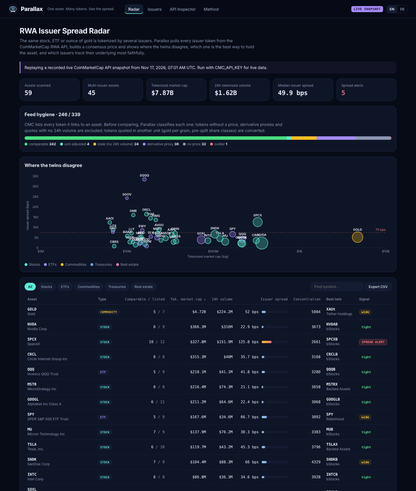
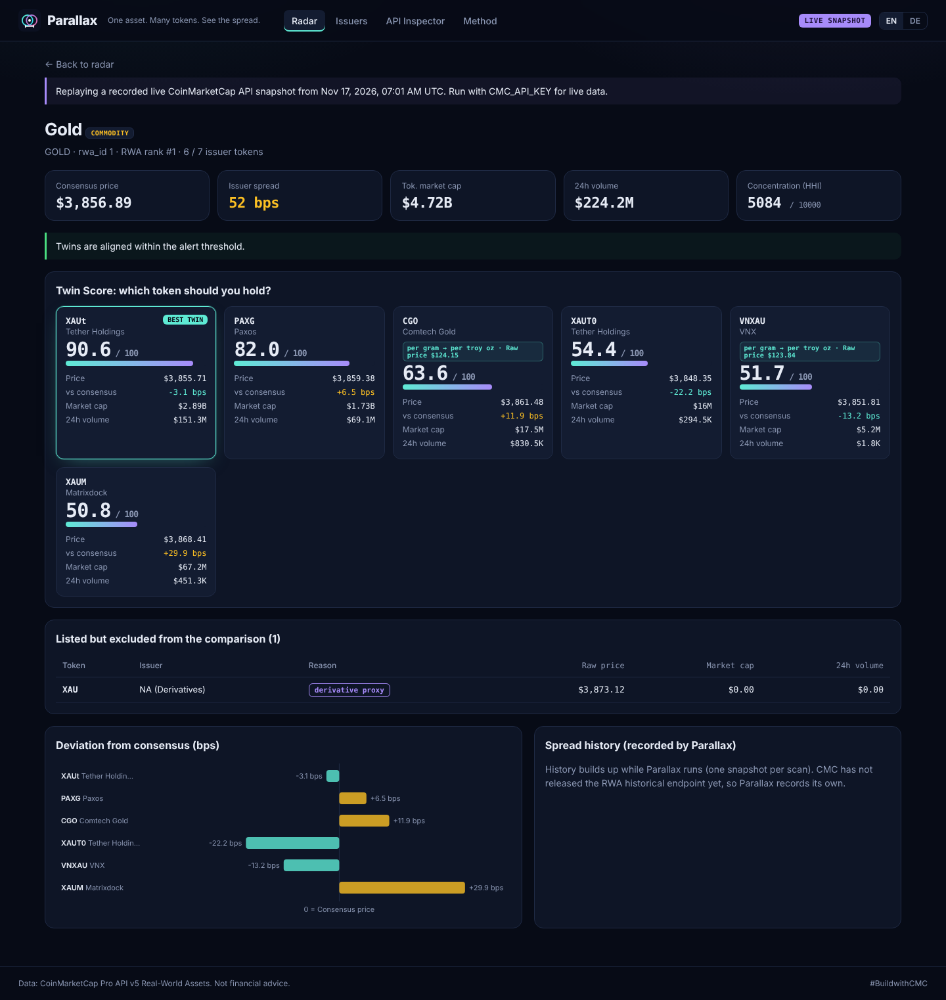
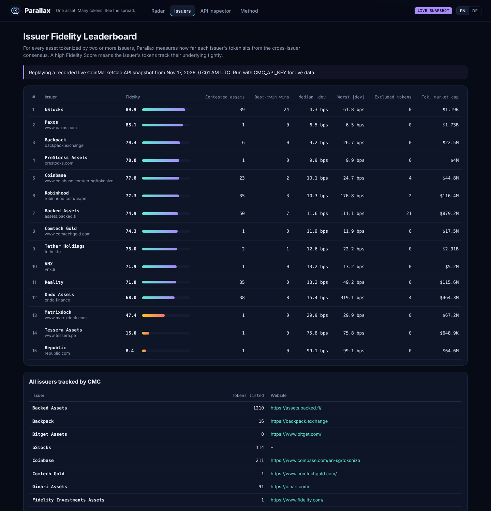
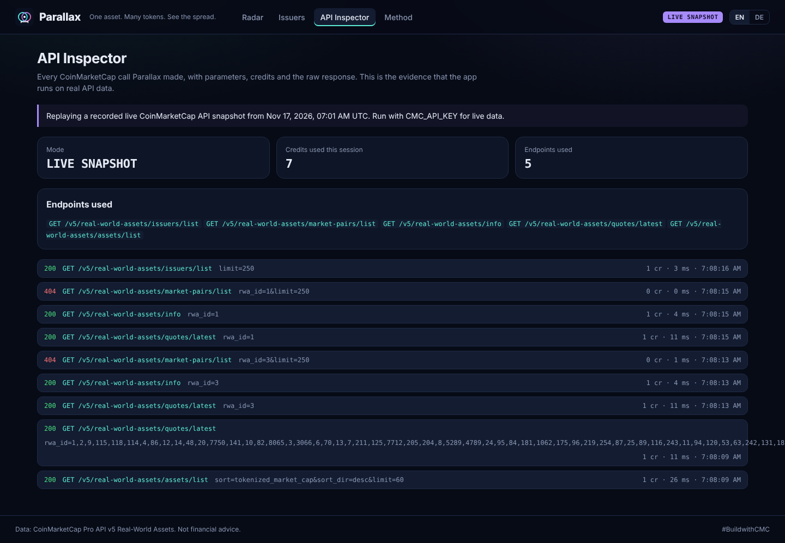

<p align="center">
  
</p>

<h1 align="center">Parallax</h1>
<p align="center"><b>One asset. Many tokens. See the spread.</b><br>
An RWA issuer spread radar built on the CoinMarketCap Pro API v5 Real-World-Asset endpoints.</p>

<p align="center">
  🎥 <a href="https://youtu.be/WVRfNKGDobg"><b>Watch the 2-minute demo</b></a>
</p>

<p align="center">
  Track: <b>Real World Assets</b> · Build with CMC: API Hackathon Round 2 · <code>#BuildwithCMC</code>
</p>

---

## The problem

Nvidia is not one token on-chain. It is `NVDAX` from Backed, `NVDAon` from Ondo, a Dinari dShare and more. Gold is `PAXG`, `XAUt`, `XAUm`, `KAU`, `CGO`. Every issuer has its own custody, liquidity and venues, so the "same" asset trades at **different prices depending on whose token you hold**.

Nobody shows you that gap. Price sites show one blended number. If you buy a tokenized stock you have no idea whether you picked the token that tracks the underlying, or the one sitting 80 bps off with no liquidity.

## What we found in the live data

From a live CoinMarketCap API snapshot (17 Nov 2026, top 59 tokenized assets by market cap, $7.9B tokenized market cap):

- **339 issuer tokens** are linked to those 59 assets. **45 assets** have two or more comparable issuers.
- The **median issuer spread is ~50 bps**: buying "the same" stock from a different issuer typically costs half a percent more or less.
- **5 liquid spread alerts** (both legs ≥ $50K daily volume), e.g. SQQQ 334 bps, GME 160 bps, SpaceX 126 bps, AVGO 89 bps, USO 78 bps.
- Only **246 of 339 tokens** are directly comparable. 32 have no price, 36 are derivative proxies, 24 have no 24h volume, 1 is an outlier, and 4 are quoted in a **different unit** (gold per gram instead of per troy ounce, a SpaceX token at a 4:1 share ratio). A naive comparison reports a 9,756 bps "spread" on gold; after unit normalisation it is 52 bps.

## What Parallax does

Parallax pulls **every issuer token for every RWA asset** from the CoinMarketCap API, builds a consensus price per asset and answers three questions:

| Question | Parallax feature |
|---|---|
| Where do the issuer twins of the same asset disagree right now? | **Spread Radar**: all tokenized assets ranked, issuer spread in bps, bubble chart, spread alerts |
| Which token should I hold for this asset? | **Twin Score** (0–100) per token: price fidelity, liquidity, size, venue breadth |
| Which issuers track their underlying most faithfully? | **Issuer Fidelity Leaderboard** across all multi-issuer assets |

Plus:

- **Feed hygiene**: every token is classified before it is compared (comparable · unit-adjusted · stale · derivative proxy · no price · outlier). Gold quoted per gram is converted to per troy ounce, share classes at an integer ratio are rescaled, junk is listed separately with the reason.
- **Asset deep dive**: deviation chart per token, every market pair with its venue price vs. consensus, cross-venue dispersion, TradFi listing links.
- **Spread history**: CMC's RWA historical endpoint is not public yet, so Parallax records its own snapshots on every scan.
- **Spread alerts**: fire when the spread exceeds a threshold (default 75 bps) *and* both legs are liquid (≥ $50K/day), optional push to Telegram.
- **API Inspector**: every CMC call the app made, with parameters, credits used, latency and the raw JSON response, visible inside the app.
- **CSV export** of the radar.
- **English / German** UI.
- **Three modes**: `live` (your key), `snapshot` (replays responses recorded from the live API with `npm run live-check`) and `demo` (synthetic fixtures that mirror the live response shapes, so anyone can try it in 30 seconds without a key).

## Screenshots

| Radar | Asset deep dive |
|---|---|
|  |  |
| **Issuer Fidelity** | **API Inspector** |
|  |  |

## CMC API endpoints used

All seven endpoints of the v5 Real-World-Asset family:

| Endpoint | Used for |
|---|---|
| `GET /v5/real-world-assets/assets/list` | Rank the RWA universe by `tokenized_market_cap`, filter by `asset_type` |
| `GET /v5/real-world-assets/quotes/latest` | One batched call returns every issuer token (`tokens[]` with price, market cap, volume, issuer) per asset, plus `tradfi_markets` |
| `GET /v5/real-world-assets/market-pairs/list` | Venues, per-venue price and volume per issuer token (venue breadth, cross-venue dispersion). Used when the plan allows it; the app degrades gracefully when it is refused |
| `GET /v5/real-world-assets/info` | Asset metadata on the deep-dive page |
| `GET /v5/real-world-assets/issuers/list` | Issuer directory (name, website, token count) for the leaderboard |
| `GET /v5/real-world-assets/issuers` | Expand one issuer into the tokens it has issued |
| `GET /v5/real-world-assets/map` | Symbol search → `rwa_id` |

A full radar refresh for 60 assets costs **2 credits** (one `assets/list` + one batched `quotes/latest`). Responses are cached for 55 seconds to match CMC's 60-second update cycle.

## Evidence of real API calls

- `npm run evidence` calls every endpoint above against the live API and writes request + response samples to [`docs/evidence/`](docs/evidence/) (the run log is in `docs/evidence/run.log`).
- `npm run live-check` runs the full pipeline once against the live API and saves the computed radar summary to `docs/evidence/live-radar-summary.json`.
- The in-app **API Inspector** (`/#/inspector`, JSON at `/api/inspector`) shows every live call with its `status.credit_count`, `elapsed` and the raw response.
- Code: [`src/cmc.js`](src/cmc.js) (client), [`server.js`](server.js) (pipeline), [`src/metrics.js`](src/metrics.js) (analytics).

## How the numbers are computed

- **Feed hygiene**: tokens with a null price, issuer `NA (Derivatives)` or zero 24h volume are excluded. The volume-weighted median price is the reference; a token more than 20% away is tested against unit factors (commodities: gram / troy ounce / kg; stocks and ETFs: integer share ratios 2–100). A match within 3% is rescaled and flagged as unit-adjusted, otherwise it is an outlier.
- **Consensus price**: volume-weighted mean of all issuer token prices for the asset (fallback: market-cap weights, then CMC's `average_tokenized_price`).
- **Deviation**: `(token price − consensus) / consensus` in basis points.
- **Issuer spread**: `(max token price − min token price) / consensus` in bps.
- **Twin Score**: 45% price fidelity `exp(−|dev| / 50 bps)` · 30% liquidity (log 24h volume vs. the most liquid twin) · 15% market-cap share · 10% venue breadth (deep-dive page).
- **Issuer Fidelity Score**: `100 × exp(−median |dev| / 40 bps)` across every asset the issuer shares with at least one other issuer.
- **Concentration**: Herfindahl-Hirschman index of issuer market-cap shares (0–10,000).

All formulas live in [`src/metrics.js`](src/metrics.js) and are covered by unit tests.

## Run it

Requirements: Node.js 18+. No dependencies.

```bash
git clone https://github.com/ElTanque81/parallax-rwa.git
cd parallax-rwa
cp .env.example .env        # add your CMC_API_KEY (or leave empty for demo mode)
npm start                   # http://localhost:8787
npm test                    # 14 unit tests
npm run evidence            # live call to every endpoint, saves docs/evidence/
npm run live-check          # full live run, records a snapshot to fixtures-live/
DEMO_FIXTURES=fixtures-live npm start   # replay that snapshot without a key
```

Environment variables: `CMC_API_KEY`, `PORT`, `SCAN_LIMIT` (assets per scan, max 250), `SCAN_INTERVAL_MIN`, `ARB_THRESHOLD_BPS`, `TELEGRAM_BOT_TOKEN`, `TELEGRAM_CHAT_ID`.

The API key stays on the server. The browser only talks to Parallax's own `/api/*` routes.

## Architecture

```
browser (vanilla JS, SVG charts, EN/DE)
   │  /api/radar · /api/asset/:id · /api/issuers · /api/inspector · /api/radar.csv
   ▼
server.js (Node http, zero deps)
   ├─ src/cmc.js      CMC client · 55 s cache · call log · demo fixtures
   ├─ src/metrics.js  consensus · spread · Twin Score · Issuer Fidelity · HHI
   ├─ src/store.js    spread history snapshots (JSON)
   └─ src/alerts.js   spread alerts → Telegram
   ▼
pro-api.coinmarketcap.com  /v5/real-world-assets/*
```

## API feedback

**What the API made possible.** `quotes/latest` is the star: one call returns every issuer token for up to 250 assets with price, market cap, volume *and* issuer ID. That single response is what makes a cross-issuer comparison cheap enough to refresh every minute. Without it you would have to discover each issuer's token, map it to an underlying and query it separately. The `issuer_id` link across `quotes/latest`, `issuers/list` and `issuers` makes issuer-level analytics possible out of the box.

**Where it got in the way.** Everything below was observed in real responses, not guessed from the docs.

1. **`tokens[]` mixes units with no unit field.** Gold tokens quoted per gram (CGO, VNXAU at ~$124) sit next to tokens quoted per troy ounce (PAXG, XAUt at ~$3,858), and a SpaceX token trades at a 4:1 share ratio. Without a `unit` / `multiplier` field every consumer has to infer it; a naive average or spread is meaningless (9,756 bps on gold).
2. **Derivatives, null prices and dead tokens inside `tokens[]`.** 36 of 339 entries are derivative proxies (issuer `NA (Derivatives)`, market cap 0), 32 have `price: null`, 24 have no 24h volume. A `token_type` (spot / wrapped / derivative) and an `is_active` flag would save every client the same cleanup.
3. **Duplicate symbols.** The same symbol appears for several issuers (`SPCX` from Backpack, Robinhood and a derivative), so tokens must be keyed by `crypto_id`, not symbol.
4. **`status.error_code` is the string `"0"`.** The docs show a number; a strict `!== 0` check treats every successful response as an error.
5. **`assets/list` can return `rwa_id: null`.** One entry (HON, `has_tokens: false`) has a null ID, and passing that list straight into `quotes/latest` fails the whole batch with "Invalid parameter".
6. **`market-pairs/list` is refused on the free key** ("Your API Key subscription plan doesn't support this endpoint"), although the reference lists it for Basic.
7. **No underlying (TradFi) reference price.** `tradfi_markets` lists where the stock trades but not its price, so premiums can only be measured against other tokens, not the real share.
8. **No RWA history yet, and token prices have no timestamp.** Spread history has to be self-recorded, and a stale quote on a thin token looks like a real deviation.

## Disclaimer

Parallax is an analytics tool, not financial advice. Tokenized stocks and commodities carry issuer, custody, redemption and jurisdiction risk; a price spread between issuers is not automatically a risk-free trade.

## License

MIT
